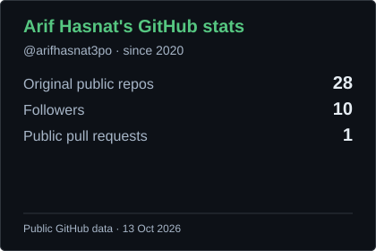
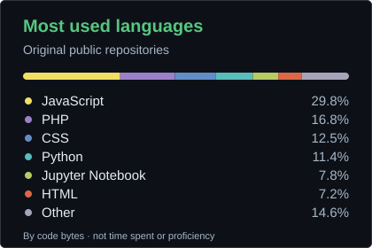
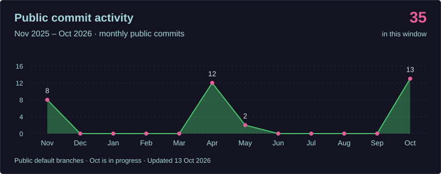
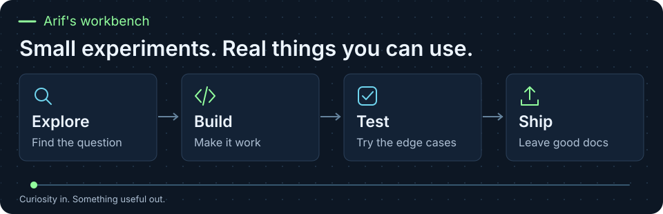

<div align="center">
  <picture>
    <source media="(prefers-reduced-motion: reduce)" srcset="assets/profile-cover-static.svg" />
    
  </picture>
</div>

<br />

<div align="center">
<p>
<a href="mailto:arifhasnat83@gmail.com"></a>
<a href="https://linkedin.com/in/arif-hasnat"></a>
<a href="https://twitter.com/arifhasnat7"></a>
<a href="https://kaggle.com/arifhasnatr2"></a>
</p>
<p>


</p>
</div>

---

## About Me

I am a software and technology learner focused on **Machine Learning**, **Cybersecurity**, and **Computer Networking**.  
I enjoy turning complex ideas into clean, useful, and reliable projects.

- Currently working on: **Machine Learning projects**
- Currently learning: **CCNA, Network Security, and Machine Learning**
- Ask me about: **Networking, Cybersecurity, Python, and ML basics**
- Goal: Build practical tools that solve real problems
- Reach me at: **[arifhasnat83@gmail.com](mailto:arifhasnat83@gmail.com)**

---

## Public GitHub snapshot

<!-- PROFILE-SNAPSHOT:START -->
<p>
<picture>
  <source media="(prefers-color-scheme: dark)" srcset="assets/github-stats-dark.svg" />
  
</picture>
<picture>
  <source media="(prefers-color-scheme: dark)" srcset="assets/github-languages-dark.svg" />
  
</picture>
</p>

<picture>
  <source media="(prefers-color-scheme: dark)" srcset="assets/github-activity-dark.svg" />
  
</picture>

**28 original public repositories · 10 primary languages · PixelPair v0.9.4**

<!-- PROFILE-SNAPSHOT:END -->

---

## Core Interests

<table>
  <tr>
    <td align="center" width="33%">
      
      <br />
      <strong>Machine Learning</strong>
      <br />
      <sub>Data, models, prediction, and automation</sub>
    </td>
    <td align="center" width="33%">
      
      <br />
      <strong>Cybersecurity</strong>
      <br />
      <sub>Security fundamentals, Linux, and defense</sub>
    </td>
    <td align="center" width="33%">
      
      <br />
      <strong>Networking</strong>
      <br />
      <sub>CCNA, routing, switching, and protocols</sub>
    </td>
  </tr>
</table>

---

## Tech Stack

### Languages

<p>
  
</p>

### Machine Learning & Data

<p>
  
  
  
  
</p>

### Databases & Backend

<p>
  
</p>

### Tools & Operating Systems

<p>
  
</p>

---

## Featured Focus Areas

```txt
Machine Learning     ███████████████░░░░░   Learning & building
Cybersecurity        ██████████████░░░░░░   Security fundamentals
Networking / CCNA    ███████████████░░░░░   Routing, switching, protocols
Python Development   ████████████████░░░░   Automation and problem solving
Databases            ████████████░░░░░░░░   SQL and NoSQL basics
```

---

## From packets to products

<picture>
  <source media="(prefers-reduced-motion: reduce)" srcset="assets/workbench-static.svg" />
  
</picture>

My repositories connect a few different worlds: **networking labs**, **Python experiments**, **web applications**, and **WordPress tools**. I like the point where understanding how something works turns into making something useful.

Based in **Chittagong, Bangladesh**. Building, testing, documenting, and coming back with better questions.

## Selected builds

### PixelPair · A project you can install

Marketing tracking for WordPress, with Meta Pixel and Conversions API, Google Analytics, TikTok, WooCommerce, and Easy Digital Downloads. One place to configure connections, choose events, and inspect delivery results.

What makes this project interesting to me: browser/server event matching, consent-aware tracking, authenticated AI-tool access, and making a technical setup understandable to a site owner.

**JavaScript · PHP · WordPress · Playwright · GitHub Actions**

[Explore the source](https://github.com/arifhasnat3po/pixelpair-plugin) · [Get the installable release](https://github.com/arifhasnat3po/pixelpair-plugin/releases/latest) · [Read the illustrated guides](https://arifhasnat3po.github.io/pixelpair-plugin/)

| Project | What you will find | Built with |
| :--- | :--- | :--- |
| [StreamVision](https://github.com/arifhasnat3po/StreamVision) | A playlist-based video player: upload an M3U playlist, browse channels, and choose a stream. | React, TypeScript, Vite |
| [Social Media Web Application](https://github.com/arifhasnat3po/Social-Media-Web-Application) | A full-stack project with accounts, profiles, posts, comments, and likes. | React, Node.js, Express, MongoDB |
| [Portfolio](https://github.com/arifhasnat3po/portfolio.io) | A personal site with a theme switcher, project filtering, and content managed from one data file. | HTML, CSS, JavaScript |

## Inside the lab

Some repositories are finished projects. Others are the notebook beside the project: exercises, experiments, and the steps that helped an idea click.

<details>
<summary><strong>Open the networking and security drawer</strong></summary>

| Repository | Explore |
| :--- | :--- |
| [Cisco Packet Tracer Labs](https://github.com/arifhasnat3po/CiscoPacketTracerLabs) | Routing, VLANs, DHCP, NAT, ACLs, IPv6, and multi-router topologies. |
| [The Wireshark Script Repository](https://github.com/arifhasnat3po/TheWiresharkScriptRepository) | My packet-analysis learning repository. |
| [Web Penetration](https://github.com/arifhasnat3po/WebPenetration) | My web-security learning repository. |
| [CryptoLab](https://github.com/arifhasnat3po/CryptoLab) | Cryptography lab work in Java. |

</details>

<details>
<summary><strong>Open the programming and experiment drawer</strong></summary>

| Repository | Explore |
| :--- | :--- |
| [Python 100 Days Bootcamp](https://github.com/arifhasnat3po/Python100DaysBootcamp) | Python practice and learning exercises. |
| [Django Projects](https://github.com/arifhasnat3po/Django-Projects) | Python web-development experiments. |
| [Learning CS50](https://github.com/arifhasnat3po/LearningCS50) | Computer-science practice, starting with C. |
| [SQL](https://github.com/arifhasnat3po/SQL) | Database exercises and SQL practice. |
| [Gemini AI](https://github.com/arifhasnat3po/GEMINI_AI) | A notebook-based AI experiment. |
| [Tic-tac-toe](https://github.com/arifhasnat3po/tictactoe) | A small JavaScript game. Sometimes the best lab has nine squares. |

</details>

### How I like to build

- **Understand the path.** Follow the request, the packet, or the event before guessing.
- **Make one useful thing work.** Start with a small, working version.
- **Test the awkward cases.** Empty states, permissions, retries, and the narrow screen count too.
- **Leave a trail.** Write the setup steps and include screenshots so the next person can follow.

<details>
<summary><strong>A tiny terminal, just for fun</strong></summary>

```console
$ whoami
Arif Hasnat / arifhasnat3po

$ pwd
/bangladesh/chittagong/the-lab

$ cat interests.txt
models, packets, practical tools

$ git switch learning-by-building
Switched to a branch that never quite ends.

$ echo "C3p0 mode"
Let the machine handle the repetitive part.
```

The terminal is a little profile Easter egg. The repositories above are the real work.

</details>

## Let's build something useful

Have a **WordPress integration**, **Python automation**, **web app**, or **networking experiment** in mind? Send the problem, what you have tried, and a link if you have one. That is a good place to start.

[Email me](mailto:arifhasnat83@gmail.com) · [Connect on LinkedIn](https://linkedin.com/in/arif-hasnat) · [Explore all public repositories](https://github.com/arifhasnat3po?tab=repositories)

<p align="center"><sub>Trace the packet. Question the model. Ship the useful thing.</sub></p>
